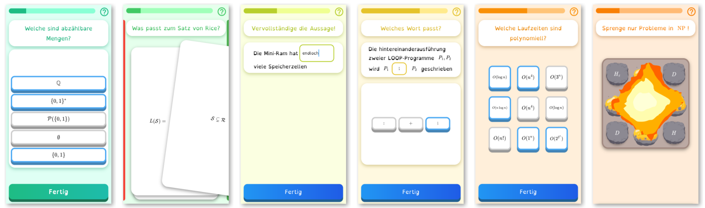

# FocusLocus

A learning application that supports different kinds of exercises and frames each exercise in more than one way. It also can be used to collect learning data and is specialized for finding differences between the learning behavior of people with ADHD and others.

